# Project assessment before the personal rebrand and Discord extension

Assessment date: 13 October 2026, Asia/Kuala_Lumpur. Reviewed checkout: `8b0b4c6`.

Update, 14 October 2026: step 1 established the locked Python/Node environments. All 67 parameter-expanded backend tests pass on Python 3.13.13 (one dependency deprecation warning); frontend typecheck and production build pass on Node 24.18.0/npm 11.8.0. The original verification-limit section below records the environment on 13 October. Feature gaps remain until implementation; the updated direction is in the proposed personal-agent design.

## Verdict

This is a substantial single-operator prototype, with a backend and a dashboard connected to it. It is not complete against the original README specifications, and end-to-end live readiness cannot be established from this checkout. The README combines an original hackathon design with later implementation notes; some missing items are intentionally replaced designs rather than features that need restoring.

The intended next product is a personal meeting assistant that can be summoned into a Discord voice channel with `/join`, take notes while its owner is absent, and answer addressed questions from its knowledge. The owner confirmed that Discord answers should be spoken in the voice channel only. Knowledge sources, the final brand name, and where completed Discord notes should be delivered remain to be defined.

This report is a code assessment and a proposed order of work, not an approved implementation design. No application behavior was changed.

## Actual architecture and technology

The current implementation is organized around FastAPI and a Recall adapter, rather than the directory layout shown in the original README.

```mermaid
flowchart LR
    Web[Next.js dashboard] -->|Server-side bearer token| API[FastAPI]
    API --> DB[(SQLite)]
    API --> Worker[Recall job worker]
    Worker --> Recall[Recall meeting bot]
    Recall -->|Signed transcript and lifecycle webhooks| API
    Worker --> Gate[Name and follow-up gate]
    Gate --> Retrieval[Session note retrieval]
    Retrieval --> Brain[OpenAI Responses API]
    Brain --> TTS[ElevenLabs MP3 synthesis]
    TTS --> Outbox[SQLite audio outbox]
    Outbox --> Media[Recall Output Media webpage]
    Media --> Recall
    Recall --> Final[Final transcript download]
    Final --> Minutes[OpenAI Markdown minutes]
    Minutes --> DB
    OAuth[Optional OAuth context imports] --> API
```

| Area | Actual implementation |
| --- | --- |
| Backend | Python 3.13 requirement, FastAPI, Pydantic, Uvicorn; dependencies managed through `uv` |
| Persistence | SQLite sessions, notes, transcript, Q&A, minutes, events, encrypted OAuth credentials; additional Recall jobs, bot state, audio, calendars, and transcript artifacts |
| Meeting participation | Recall REST API, Tokyo region; supported meeting URLs are Google Meet, Zoom, and Teams |
| Live transcription | Recall streaming transcription webhooks; no local microphone/audio transcription implementation |
| Reasoning | OpenAI Responses API; defaults are `gpt-4.1-mini` for answers/coaching and `gpt-5-mini` for minutes, configurable through settings |
| Retrieval | Local substring/token overlap scoring over session notes; not BM25 or embeddings |
| Voice | ElevenLabs `eleven_flash_v2_5`, Charlie by default; entire `mp3_44100_128` output collected before playback |
| Frontend | Next.js 16, React 19, TypeScript, CSS modules, `react-markdown`; exact declared versions in the manifest |
| Frontend data | Server-side backend client and Server Actions; server refresh polling every 3–5 seconds while sessions are considered live |
| Context imports | Google Calendar/Meet metadata, Slack channel history, Microsoft Calendar/Teams chat, Zoom past-meeting metadata |
| Authentication | One shared backend operator token; no frontend login or per-user access control |

Evidence: [backend initialization](C:/Users/aloys/discord-bot-meeting-note/src/meeting_agent/api.py:60), [Recall pipeline](C:/Users/aloys/discord-bot-meeting-note/src/meeting_agent/recall.py:177), [AI and voice services](C:/Users/aloys/discord-bot-meeting-note/src/meeting_agent/services.py:224), [frontend backend client](C:/Users/aloys/discord-bot-meeting-note/apps/web/lib/backend.ts:46), [Python manifest](C:/Users/aloys/discord-bot-meeting-note/pyproject.toml), [frontend manifest](C:/Users/aloys/discord-bot-meeting-note/apps/web/package.json).

## Specification coverage

“Implemented” below means code exists and was traced. It does not mean a fresh full suite or live provider test passed during this assessment.

| Specification | State | Evidence and remaining gap |
| --- | --- | --- |
| Sessions, meeting history, transcript/Q&A/event persistence | Implemented | SQLite repository and authenticated API endpoints are present. No meeting deletion, archival, or pagination. |
| Dashboard connected to backend | Implemented | Pages load sessions, bot state, events, transcript and minutes through `lib/backend.ts`. Server Actions create sessions, save briefings, launch/leave bots, speak and generate minutes. The README fixture-only claim is stale. |
| Real meeting join, announcement and voice output | Implemented via Recall; live unverified here | Bot configuration sends an AI/transcription notice, accepts Meet/Zoom/Teams links, uses Output Media. No Playwright Meet bot or PulseAudio devices exist. Those parts of the original design were replaced. |
| Caption aggregation and revision handling | Missing as a shared component | API callers can mark captions final; Recall ingestion stores every accepted `transcript.data` payload as final. No timestamp-based aggregator, cumulative-caption revision handling, or pause finalization. Provider behavior must supply the required utterance boundaries. |
| Three-stage speaking gate | Partial; behavior changed | Direct-address matching, a limited Alloy/Aloy alias, same-speaker follow-up windows, stale-message guards and a bounded live reply queue exist. No model confirmation stage, general fuzzy wake matching, cooldown, consecutive-answer cap, or human-speaking check. Greetings and addressed statements can receive replies. |
| Ignore its own voice | Partial | Recall ingestion filters speakers whose displayed name matches the agent, and its recording configuration excludes bot audio. The shared gate and `/utterances` route have no equivalent speaker guard. |
| Answers with confidence, defer and grounded citations | Partial | The brain returns plain text, and `AgentDecision` has only `answer` or `stay_silent`. No confidence threshold or structured `defer`. Citations list retrieved notes, regardless of what the answer actually used. Unknown-answer behavior is instructed through the model prompt. |
| Personal knowledge across meetings | Missing | Notes are attached to each session. Persisted past minutes and transcripts are not automatically searched for future meetings. Calendar scheduling can copy a template session's notes, but this is not a personal knowledge library. |
| Context pack from Slack, calendar and Drive | Partial | Manual text notes and explicit provider imports exist. Calendar scheduling copies template notes. No Drive import, attachment fetching, document parsing/upload, automatic briefing builder, or in-meeting chat ingestion. Imports are bounded snapshots rather than continuous synchronization. |
| Offline BM25 retrieval | Replaced with simpler retrieval | `retrieve_context` is local and credential-free, but uses overlap scoring, not `rank-bm25`. No BM25 fixtures/tests. |
| Offline simulator and interchangeable platform protocols | Missing | No `MeetingPlatform`, `ContextIndex`, original `Responder` contract, simulator, YAML meetings or fixture directories. `Brain` and `Voice` protocols exist with test fakes; no runnable zero-credential product pipeline. Planned CLI commands have no registered entry point. |
| Voice streaming and interruption | Partial | MP3 synthesis and serial media playback exist. No streamed PCM delivery, barge-in, or stop-speaking/mute control. Leaving a call is available, but is different from muting replies. |
| Dual-source WAV plus ElevenLabs Scribe transcription | Replaced | Recall provides live and final transcripts. No local WAV recorder, Scribe pass, caption/audio speaker reconciliation, or independent STT fallback. |
| Under 2.5 seconds to the first audible word | Unverified and not measured as specified | Backend records model/TTS/ready-audio timings. They exclude upstream transcription and actual playback start. No frontend latency HUD was found, and no fresh audible-latency measurement exists. |
| Complete structured minutes | Partial | Automatic generation after `transcript.done` and manual regeneration produce Markdown with Summary, Decisions, Action Items, Open Questions and Assistant Q&A. No validated structured result, required attendee/agenda/topic/source-quote fields, separate needs-owner queue, or complete long-meeting coverage. |
| Minutes delivery/export | Partial | UI renders and copies minutes; Markdown download and text/Markdown/JSON transcript exports exist. No standalone minutes HTML export or Slack delivery. |
| Searchable/manageable meeting library | Partial | Persistent meeting views and recent-meeting filtering exist. Homepage shows at most 30 recent sessions; no full-history search, edit/delete/archive management or backend pagination. |
| Calendar V2 automatic joins | Implemented; live unverified here | Explicit opt-in, template notes, event synchronization, deduplication, rescheduling/unscheduling and disconnect routes exist. OAuth setup and provider behavior still require live verification. No calendar-management UI. |
| OAuth accounts | Partial | Authorization-code flows and encrypted credential storage exist. No token-expiry checks/refresh renewal, and one integration per provider for the whole database. No account-linking UI. |
| Private coaching | Implemented in API | `/coach` suggests wording without automatically speaking; no coaching UI was found. |
| Rebrand | Incomplete | `Alloy`, `Aloy`, `Aloy-bot`, `Meeting Agent` and `agents-everywhere` remain across defaults, metadata, media page and documentation. Session agent names are configurable, but the media card still hardcodes Alloy. |
| Discord server extension | Missing | No Discord dependency, bot application/token configuration, command registration, guild/channel identity, audio receive/transcription, Discord playback or lifecycle handling. |
| Delivery quality checks | Partial | Four backend test files contain 33 test functions, including parameterized cases. No committed CI workflow, frontend test suite, scripted simulator integration test or rendered-minutes snapshot test was found. |

## Findings that directly affect the new product

### 1. Knowledge support is not enforced

[Retrieval](C:/Users/aloys/discord-bot-meeting-note/src/meeting_agent/services.py:129) selects the first notes when there is no lexical match. [Citation construction](C:/Users/aloys/discord-bot-meeting-note/src/meeting_agent/services.py:197) then attaches every selected note. A focused execution of these exact functions returned a cafeteria-maintenance note for a question about the refunds migration, and cited that note.

This does not prove the live model hallucinates an answer. It proves retrieval and citations do not establish that an answer is supported. The requested “reply if the answer is found in the agent knowledge” requires explicit evidence validation and a decision when no supported answer exists.

### 2. Meeting knowledge is scoped to a session

The answer path loads only `repository.get_context(session_id)` and recent dialogue. There is no automatic search over previous meetings or a persistent owner knowledge collection. Merely retaining transcripts does not make them available to later answers.

### 3. Minutes can omit the beginning of a long meeting

[Minutes input construction](C:/Users/aloys/discord-bot-meeting-note/src/meeting_agent/services.py:337) includes only the last 500 transcript entries, truncates each entry to 4,000 characters, and supplies context titles rather than note contents. Earlier decisions can be omitted without any truncation notice. The model headings also cover less than the original minutes specification.

### 4. The UI can stop updating before notes are ready

[Terminal-state handling](C:/Users/aloys/discord-bot-meeting-note/apps/web/lib/meeting.ts:23) treats `call_ended` as final, and the [meeting page](C:/Users/aloys/discord-bot-meeting-note/apps/web/app/meetings/[id]/page.tsx:124) refreshes only while `isLive` is true. If `transcript.done` and minutes arrive after the call-ended refresh, the page will not poll for them. The backend can finish successfully while the screen continues to show no minutes until another refresh. This is a source-traced issue; browser reproduction was unavailable in the current setup.

### 5. The portable caption-processing boundary does not exist yet

The authenticated `/utterances` endpoint produces a text decision, while [Recall transcript processing](C:/Users/aloys/discord-bot-meeting-note/src/meeting_agent/recall.py:532) additionally handles speaker exclusion, deduplication, stale-data checks, queue capacity, model timing, TTS and playback. A new Discord implementation would otherwise have to duplicate those behaviors or couple itself to Recall tables.

The current Recall worker also processes jobs serially across the database, including model and TTS waits. A slow answer can delay later transcript/lifecycle jobs, and old addressed captions can be skipped after 30 seconds. This limits simultaneous meeting support.

### 6. Live timestamps and identity need stronger contracts

Recall ingestion creates `UtteranceCreate` without a provider speech timestamp, so live `spoken_at` is processing time. Final artifacts do use provider absolute timestamps. This affects live timeline fidelity and the gate's timing windows. Speaker handling uses display names rather than stable participant IDs; a Discord adapter should preserve stable user IDs and original speech timestamps.

Calendar-created sessions also copy notes without emitting `context.added` events. The dashboard reconstructs briefing notes solely from those events, so copied notes can be available to the brain while absent from the briefing panel.

### 7. The original silence guarantee is no longer the implemented behavior

A focused execution of `should_answer` returned `True` for `Alloy, the launch is Friday.` and for `Hi Alloy`, and `False` for an unaddressed budget question. This agrees with the newer conversational intention but differs from the original requirement to require both an address and a response request. The new product needs an explicit choice between conversational responses and strict factual-question responses.

Own-voice filtering is specific to Recall; directly invoking the shared gate with the agent as speaker still permits an addressed reply. There is no shared human-speaking or interruption guard.

### 8. Access control assumes a trusted local operator

The backend bearer token is kept server-side by Next.js, which is useful, but the frontend has no login. Its pages, downloads and Server Actions can use that token on behalf of whoever reaches the frontend. There are no user, guild or channel ownership checks. A personal Discord deployment at least needs command authorization and an allowlist of permitted guilds/channels; a multi-user product needs a separate access-control design.

This is a readiness assessment, not a dedicated security audit.

## Documentation reconciliation

- README status says the frontend is fixture-backed; the latest code is wired to the backend.
- `BACKEND_HANDOFF.md` references `apps/web/lib/data.ts`, which does not exist in this checkout; current reads use `lib/backend.ts`.
- The original README tree, browser/audio architecture, protocols and simulator describe a plan, not the present implementation.
- “Teams is not built” is obsolete as a statement of the adapter's URL coverage: the Recall path accepts Teams and Zoom too. Live support is still unverified here.
- The `live` and `api` optional dependency groups mentioned in README do not exist in `pyproject.toml`; actual dependencies are in the main group.
- The README's 19-test count is stale: 33 test functions exist before parameter expansion. That is an inventory, not a pass count.
- Newer handoff documentation explicitly disclaims live verification, full-duplex audio, token refresh and Drive import. Those disclaimers should be preserved when updating product claims.

## Verification performed and limits

| Check | Fresh result |
| --- | --- |
| Read README, handoff/runbook, source, manifests, tests and recent commits | Completed |
| `uv run pytest -q` | Could not start: `uv` is not installed/on PATH; no project `.venv` present |
| `npm.cmd run typecheck` in `apps/web` | Could not start TypeScript: `tsc` not found; `node_modules` absent |
| `npm.cmd run build` in `apps/web` | Could not start Next.js: `next` not found; `node_modules` absent |
| Python syntax parsing | All 19 Python source/test/script/entrypoint files parsed with the available bundled Python 3.12.14; not verification on the project's required Python 3.13 |
| Focused gate/retrieval probes | Executed exact AST-extracted pure functions, confirming addressed-statement behavior, lack of a shared speaker guard, and unrelated-note fallback/citations |
| Live OpenAI, ElevenLabs, Recall meeting, calendar consent and public webhook delivery | Not performed; no provider readiness claims |
| Browser UI validation | Not performed because the frontend could not build/start |

The focused probes do not replace the backend suite. No provider credentials were printed, no API credits used and no live bot was launched.

## Discord implications and suggested order

Discord is a new input/output adapter. Existing session persistence, model services and minutes storage can be reused, but joining a Discord server requires a separate bot and voice transport; a Discord channel is not a supported Recall meeting URL.

The `/join` command can have a typed channel option restricted to voice channels, giving a channel picker and a stable channel ID rather than relying on an ambiguous name. This follows [Discord's application-command documentation](https://docs.discord.com/developers/interactions/application-commands).

The selected voice stack must receive as well as send audio, preserve speaker identity, handle reconnections, and support Discord's DAVE end-to-end encryption. Discord voice also expects Opus audio at 48 kHz stereo, so the existing MP3 output requires conversion or a different TTS output path. These are current platform requirements, not implemented capabilities of this repository. See [Discord's official voice documentation](https://github.com/discord/discord-api-docs/blob/main/developers/topics/voice-connections.mdx).

Recommended sequence:

1. Establish a reproducible Python 3.13/backend and Node/frontend setup; rerun the existing suite, typecheck and build. Update the README to the actual architecture and verified status.
2. Define the personal brand and knowledge scope. Implement supported-answer/unknown-answer decisions, reliable citations and access checks appropriate to a personal Discord bot.
3. Extract the common transcript-to-decision-to-voice pipeline, retaining Recall as one adapter; define stable speaker IDs, speech timestamps, meeting finalization and playback controls.
4. Verify one Discord voice connection can receive human audio and play synthesized speech using a DAVE-compatible stack. Select STT after checking this transport boundary.
5. Add `/join`, departure/mute controls, speaker-labelled transcription, voice-only grounded answers, and automatic notes on meeting completion. Reuse the dashboard for stored meeting records and explicitly decide where the owner receives the notes.
6. Validate the whole Discord flow, including unsupported questions, overlapping speech, self-voice, disconnects, empty channels, duplicate command submissions and long-meeting minutes.

Drive import, Slack posting, browser-based Meet automation and restoring every original hackathon milestone are not prerequisites for a useful personal Discord assistant. The priority is a dependable knowledge boundary and meeting lifecycle around the requested voice-only workflow.
